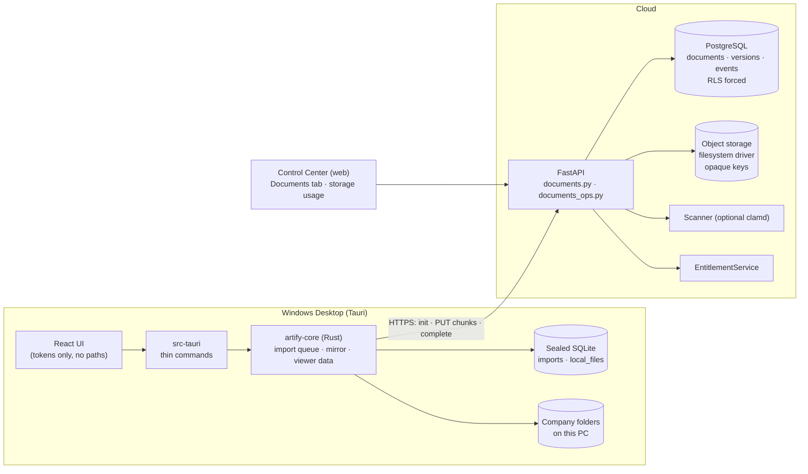

# Document Management Architecture (Phase 6)

**Status: implemented and delivered for review.** What is and is not verified is listed in [`../development/PHASE_6_COMPLETION_REPORT.md`](../development/PHASE_6_COMPLETION_REPORT.md).

## What Phase 6 is

The first phase in which real customer files enter the system. It adds: a private **object store** behind an interface, **resumable uploads** with server-side validation, **documents with immutable versions**, **search and filters**, **duplicate detection**, **naming and filing suggestions** from the company's own configuration, **archive / remove / permanently delete** with retention and legal hold, **storage usage and quotas**, and the Desktop **import, upload queue, document views, viewer and local mirror**. Out of scope (later phases): OCR, AI classification/extraction, accounting, VAT, reconciliation, Excel, mobile, full offline sync.

## Principles (all from the project invariants)

1. **The cloud is the source of truth and is private.** The database holds metadata and an opaque storage key, never file bytes. Nothing is publicly readable and **no signed or public URLs exist**: every download is an authenticated, audited stream through the API.
2. **The workspace decides where a document goes.** A document references a workspace **node** (section/folder) and an optional **category** by stable id. No category, section or folder name is written in code; a company with no workspace configuration cannot receive documents (there is nowhere to put them) and the Desktop says so.
3. **Originals are immutable.** A stored version never changes (database trigger). Changing a file means a **new version**; "restore version" only moves the *current* pointer.
4. **Never trust the client.** Tenant, company, node, category and document ids are validated on the server against memberships and node permissions; anything out of scope answers 404. File type is decided from the **content**, not the name or the client's MIME type.
5. **Limits live in the EntitlementService.** Storage bytes, documents per month, maximum file size and batch size come from plans and overrides; shrinking a plan never deletes data.
6. **AI does not exist here yet.** Nothing in Phase 6 classifies, extracts or approves; filing and naming "suggestions" come from configured rules only, and missing information stays missing.

## Components

| Layer | Files | Responsibility |
|---|---|---|
| Storage driver | `services/api/src/artify_api/storage.py` | `ObjectStorage` protocol; `FilesystemStorage`: staging append at an exact offset, commit never overwrites, strict key/stage-name patterns |
| Validation | `file_validation.py`, `scanner.py` | content-based type check, executable/active-content detection, optional ClamAV |
| Domain | `documents.py` | upload sessions, finalisation, duplicates, naming/filing suggestions, metadata |
| Operations | `documents_ops.py` | list/search, detail, rename/move/archive/delete/purge, versions, streaming, events, storage usage, reconciliation |
| HTTP | `routers/documents.py` | routes (see [DOCUMENT_API_REFERENCE](DOCUMENT_API_REFERENCE.md)) |
| Database | `migrations/sql/0007_documents.sql` | tables, RLS, immutability triggers, grants, storage measurement |
| Desktop | `apps/desktop/core/src/{documents,imports,mirror}.rs`, `src-tauri`, `src/screens/{documents,import}.tsx` | import queue, document operations, local mirror, UI |
| Control Center | `apps/web/src/app/(console)/(app)/documents`, company *Documents* tab, subscription page | monitoring and storage usage only |

## Request flow for an upload (summary)

`POST /uploads` (reserve a session; checks permission on the folder, file size, batch size, quotas) → `PUT /uploads/{id}/content?offset=N` (raw bytes; the server owns the offset) → `POST /uploads/{id}/complete` (verifies size and SHA-256, inspects content, scans, checks duplicates and quotas, then stores the object and the database rows). Details: [DOCUMENT_IMPORT_AND_UPLOAD](DOCUMENT_IMPORT_AND_UPLOAD.md).

## Design choices worth knowing (also recorded in `DECISIONS.md`)

* **Backend-mediated upload, no pre-signed URLs.** The backend must validate content *before* anything is kept; a browser-to-bucket upload would store unvalidated bytes first. The cost is that the API carries the bytes (chunked, 8 MiB maximum per request by default). See ADR-033.
* **Filesystem object storage only.** An S3/MinIO driver is *not* implemented; the `ObjectStorage` protocol is the seam. Production needs an encrypted, backed-up volume or a future driver. See [CLOUD_STORAGE_ARCHITECTURE](CLOUD_STORAGE_ARCHITECTURE.md).
* **Folder permissions are enforced in the API, not in RLS.** RLS isolates organizations and companies (forced, tested); the Phase 4 node-level allow/deny engine runs in the handlers on every document operation. A database-level mirror of node grants is deferred.
* **Web Control Center is monitoring only.** The web BFF proxies text only, so uploading or viewing files from the browser is not part of Phase 6; it is a Desktop capability.
